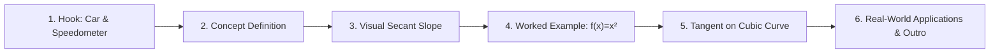

# Linear Algebra and Calculus (M3) — Internal Assessment
## Project Option 1: Animation Video

> **Topic**: Single-Variable Calculus — **Understanding Derivatives and Rate of Change**  
> **Student Name**: Suraj Patil  
> **Student ID**: E25B070541  
> **Submission Deadline**: 25th November 2026  
> **Assessment Weightage**: 10% of Internal Assessment  
> **Video Format**: 16:9 Landscape • 1080p Full HD • MP4  
> **Video Duration**: 4 minutes 46 seconds (Within recommended 5 min; strictly under 7 min limit)  

---

## 1. Project Overview & One-Sentence Learning Objective

> **Learning Objective:**  
> *"By the end of this video, the viewer will be able to intuitively connect average speed to instantaneous rate of change, geometrically explain why the tangent slope represents the derivative, step-by-step calculate the derivative of $f(x) = x^2$, and recognize how derivative gradients power real-world engineering and machine learning models."*

This animation video teaches the fundamental concepts of differential calculus visually and conceptually, bridging everyday intuition (a moving car and speedometer) with algebraic rigor (first-principles limit definition) and modern applications (deep learning backpropagation).

---

## 2. Deliverables in this Repository

| File / Folder | Description |
| :--- | :--- |
| **`M3_AnimationVideo_Derivatives_E25B070541_Video.mp4`** | Complete 1080p Full HD video with official Opening Frame (Name, ID, Topic) and Closing Frame (Summary, Credits & AI Disclosure). |
| **`Storyboard.pdf`** | Official 3-page 6-scene Storyboard containing scene goals, visual plans, narration scripts, step-by-step mathematical proofs, and viva Q&A defense preparation. |
| **`_Code/`** | Complete animation modeling and synchronization source code: |
| ├── `animate_derivatives.py` | Python module verifying first-principles limits, difference quotients, and cubic curve tangent dynamics. |
| ├── `retime_segments.py` | Frame-accurate audio-video synchronization engine with zero cumulative drift. |
| ├── `captions.srt` | Full subtitle track with exact sentence timecodes. |
| └── `requirements.txt` | Python environment dependencies. |

---

## 3. 6-Scene Video Structure



1. **Scene 1: Hook / Context (0:03 - 0:37)**  
   Motivates instantaneous rate of change through a moving car. A speedometer reading 60 km/h is contrasted against average speed.
2. **Scene 2: Concept Introduction (0:37 - 1:05)**  
   Formalizes the definition of derivative as the instantaneous rate of change at a specific moment.
3. **Scene 3: Visual Intuition (1:05 - 1:37)**  
   Animates a distance-time curve and illustrates how the secant line connecting two points approaches the tangent line as $\Delta t \to 0$.
4. **Scene 4: Worked Example (1:37 - 2:27)**  
   Step-by-step derivation of $f(x) = x^2 \implies f'(x) = 2x$ from first principles, and numerical evaluation at $x = 3$ ($f'(3) = 6$).
5. **Scene 5: Interpretation (2:27 - 3:23)**  
   Interactive cubic curve exploring tangent slope behavior:
   - Upward slope ($f'(x) > 0$): Function is increasing.
   - Downward slope ($f'(x) < 0$): Function is decreasing.
   - Horizontal tangent ($f'(x) = 0$): Turning point / local extremum.
6. **Scene 6: Real-World Applications & Summary (3:23 - 4:46)**  
   Examines three crucial domains:
   - **Physics**: Velocity ($v = ds/dt$) and Acceleration ($a = dv/dt$).
   - **Economics / Business**: Marginal cost and revenue optimization.
   - **Artificial Intelligence**: Gradient descent computing $\nabla \mathcal{L}$ for loss minimization in deep neural networks.

---

## 4. Mathematical Derivations & First Principles Proof

### Step-by-Step Proof for $f(x) = x^2$:
$$f'(x) = \lim_{h \to 0} \frac{f(x + h) - f(x)}{h}$$

1. Substitute $f(x) = x^2$:
   $$f'(x) = \lim_{h \to 0} \frac{(x + h)^2 - x^2}{h}$$
2. Expand the binomial term $(x + h)^2 = x^2 + 2xh + h^2$:
   $$f'(x) = \lim_{h \to 0} \frac{x^2 + 2xh + h^2 - x^2}{h} = \lim_{h \to 0} \frac{2xh + h^2}{h}$$
3. Factor out $h$ (valid since $h \to 0, h \neq 0$):
   $$f'(x) = \lim_{h \to 0} \frac{h(2x + h)}{h} = \lim_{h \to 0} (2x + h)$$
4. Evaluate the limit:
   $$f'(x) = 2x + 0 = 2x \quad \blacksquare$$
5. At the chosen sample point $x = 3$:
   $$f'(3) = 2(3) = 6$$

---

## 5. How to Reproduce & Run the Code

### Requirements:
- Python 3.8+
- FFmpeg 5.0+ installed on system PATH
- Python packages: `numpy`, `pillow`

### Execution:
```bash
# 1. Clone repository
git clone https://github.com/surajpatil1404/M3_AnimationVideo_Derivatives_E25B070541.git
cd M3_AnimationVideo_Derivatives_E25B070541

# 2. Run mathematical verification suite
python3 _Code/animate_derivatives.py

# 3. Verify audio-video synchronization pipeline
python3 _Code/retime_segments.py
```

---

## 6. Individual Viva / Q&A Defense Guide

- **Q1: Why does a secant line turn into a tangent line?**  
  *Answer*: A secant line cuts through two points $(x, f(x))$ and $(x+\Delta x, f(x+\Delta x))$. As $\Delta x \to 0$, the second point slides along the curve toward the first point. In the limit, the secant line achieves a unique limiting position touching the curve at exactly one point—the tangent line, whose slope is $f'(x)$.
- **Q2: Why does $f'(x) = 0$ identify stationary or turning points?**  
  *Answer*: When a function transitions from increasing ($f' > 0$) to decreasing ($f' < 0$) or vice-versa, the derivative passes through zero (Fermat's Theorem on Stationary Points). A zero derivative indicates a horizontal tangent line where the instantaneous rate of change momentarily pauses.
- **Q3: How are derivatives used in Deep Learning and AI?**  
  *Answer*: A neural network is trained by minimizing a scalar loss function $\mathcal{L}(\mathbf{w})$. Using the Multivariable Calculus Chain Rule (backpropagation), we compute the partial derivatives $\frac{\partial \mathcal{L}}{\partial w_i}$ forming the gradient vector $\nabla \mathcal{L}$. Weights are iteratively updated via Gradient Descent: $\mathbf{w} \leftarrow \mathbf{w} - \eta \nabla \mathcal{L}$.

---

## 7. Credits & Mandatory AI Tool Disclosure

- **Student Author**: Suraj Patil (Student ID: `E25B070541`)
- **Academic Course**: Linear Algebra and Calculus (M3), Fall 2026
- **Textbook References**: 
  - James Stewart, *Calculus: Early Transcendentals* (8th Edition)
  - Grant Sanderson (3Blue1Brown), *Essence of Calculus* Series
- **Mandatory AI Tool Disclosure (Per Official Project Guidelines)**:
  - AI tools were utilized to structure the 6-scene storyboard script, assist in automated frame-accurate segment retiming with FFmpeg, and verify mathematical derivations.
  - Narration audio was generated and mastered using Descript.
  - All mathematical derivations, intermediate proofs, visual plans, and presentation concepts were independently verified and explained by the student for the individual viva defense.
